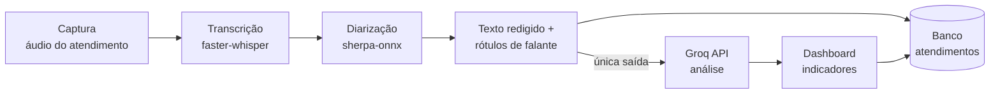

<!--
  SHOWCASE PRIVADO — apenas documentação; nenhum código-fonte.
  Quando as capturas existirem, salvar em docs/screens/ e descomentar a seção de demonstração.
-->

# Venda&Voz AI

**Varejo físico inteligente: transcreve o atendimento, identifica quem falou e transforma a conversa em indicadores de conversão.**

> **Nota:** o código-fonte é mantido em repositório **privado**. Este repositório publica apenas a documentação do produto e da arquitetura, para fins de portfólio.

---

## 📌 O problema

No varejo físico, a maior parte das interações entre vendedor e cliente **não é registrada nem analisada**. Sem esse dado, o gestor não sabe onde a venda é perdida: na abordagem, na objeção não tratada, no preço ou no tempo de resposta.

O **Venda&Voz AI** captura o áudio do atendimento, transcreve e **separa os falantes** localmente, e envia apenas o texto estruturado para análise por LLM.

---

## 🔒 Decisão central: áudio não sai da máquina

A fronteira de dados é o diferencial técnico do projeto:

| Etapa | Onde roda | O que trafega |
|---|---|---|
| Captura de áudio | Máquina local | nada |
| Transcrição (`faster-whisper`) | Máquina local | nada |
| Diarização (`sherpa-onnx`, `num_clusters=-1`) | Máquina local | nada |
| Análise (LLM) | Groq API | **apenas texto redigido**, desfecho e rótulos de falante |

Nenhum byte de áudio, caminho de arquivo ou vetor de voz atravessa a fronteira de análise — a dependência de rede não é sequer importada nos módulos de áudio.

---

## ✨ Funcionalidades

- Captura e gestão de atendimentos com áudio
- Transcrição local com timestamps por segmento
- **Diarização automática** — o motor descobre quantos falantes existem, sem fixar dois
- Análise por LLM: resumo, objeções, sinais de interesse, nota de conversão e recomendações
- Dashboard de atendimentos e indicadores
- Autenticação de usuários e pareamento de dispositivo
- Persistência com contrato de dados garantido no próprio DDL

---

## 🏗️ Arquitetura

**Módulos:** captura · áudio · diarização · análise · dashboard · autenticação · persistência.

---

## 🧰 Stack

| Área | Tecnologia |
|---|---|
| API | Python · FastAPI · Uvicorn |
| Transcrição | faster-whisper (CTranslate2) |
| Diarização | sherpa-onnx |
| Análise | Groq API (LLM) |
| Interface | Templates server-side + painel responsivo |
| Persistência | Banco relacional com contrato no DDL |
| Qualidade | Testes herméticos com transporte HTTP injetável |

---

## 🧠 Desafios técnicos resolvidos

- **Diarização sem número fixo de falantes** — `num_clusters=-1` deixa o motor decidir; o código não assume dois participantes.
- **Fronteira de dados auditável** — um único módulo pode chamar o provedor de LLM; o transporte é injetável, permitindo verificar cabeçalho e corpo sem rede.
- **Integridade garantida no banco** — cardinalidade, domínio e integridade são restrições de DDL, não validações que algum caminho de código pode esquecer.
- **Teste hermético** — uma única função abre conexão; todo o resto recebe a conexão pronta.

---

<!-- DEMONSTRAÇÃO (descomentar quando houver mídia em docs/screens/):
## 📸 Demonstração

| Fluxo | Mídia |
|---|---|
| Login e início do atendimento | `docs/screens/login.png` |
| Captura do áudio e transcrição em tempo real | `docs/screens/captura.png` |
| Análise gerada pela LLM | `docs/screens/analise.png` |
| Dashboard de indicadores | `docs/screens/dashboard.png` |
-->

## 👥 Equipe

- **Eduardo Leal** — [@dudu4leal](https://github.com/dudu4leal)
- **Arthur Rezende de Oliveira** — [@zico10-arthur](https://github.com/zico10-arthur)
- **Ian Carlos de Oliveira Leite** — [@Ianclrs](https://github.com/Ianclrs)

**Showcase mantido por** Erick Lopes — [@ErickLopesSC](https://github.com/ErickLopesSC) · [LinkedIn](https://www.linkedin.com/in/erick-lopes-2k02/)
